# PoE1 Companion setup, screen by screen

Ten steps from install to character customization. The orange boxes mark the fields you touch at that step. Every screen is the real app (0.1.11) on Windows 11.

## 1. Install

- Download the Setup file from the GitHub releases page: PoE1-Companion-Setup for PoE1, PoE2-Companion-Setup for PoE2.
- When SmartScreen appears, click "More info", then "Run anyway". The installer is not signed yet, so this shows once.
- After the install the app starts and one character appears on screen.

## 2. First run and the 2.5D character

- At first you see the gear mascot. Click it to open the feed; the "Getting started together" checklist at the top shows the order.
- The first row, "Turn on the 2.5D character": click Open, agree to the Live2D terms once, the Cubism Core downloads and the default character Hiyori appears (right). Skip it if you plan to use another look.
- Open Settings from the menu on the character's handle ("Open settings"). The tray icon menu has the same entry.

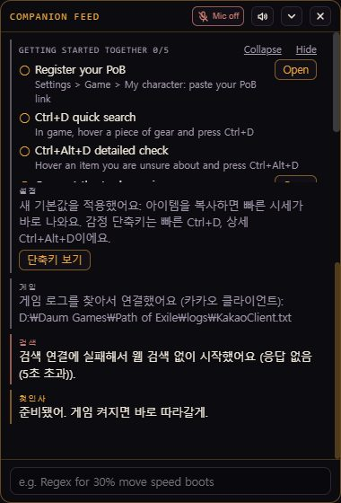

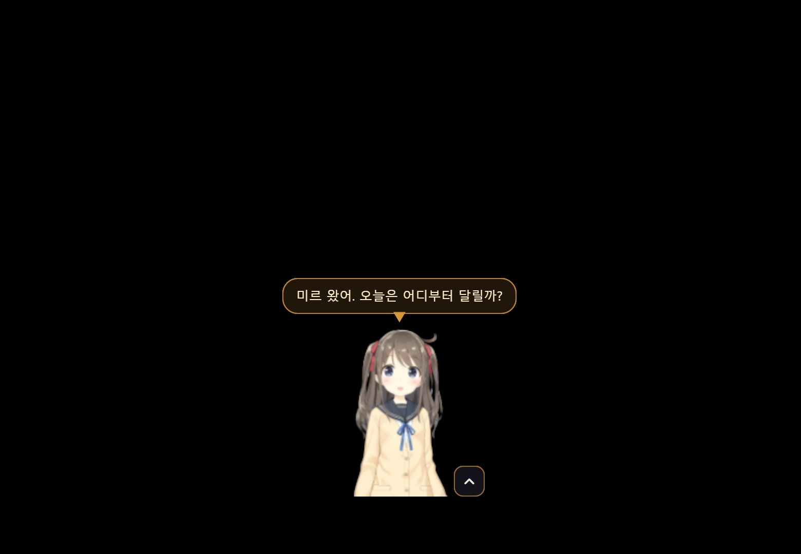

## 3. Brain key (the one field you need)

- Settings > Modules starts with "Brain (chat)". Follow the orange boxes top to bottom.
- **1** Provider: pick where you got a key: gemini, groq or openrouter. Chapter 1 of the manual shows how to get one for free.
- **2** API key: paste the key. Leave the model field empty to use the recommended model.
- **3** Test connection: within a few seconds you get a ✓ and a response time. On ✗, check the key again.
- Click "Save" at the bottom right. The character stays on screen when you close the window.

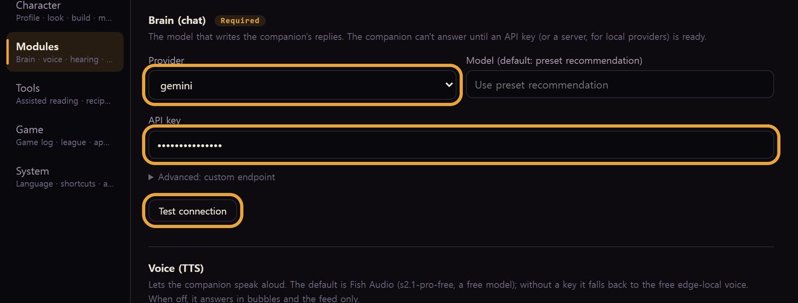

## 3-1. Starting with a trial code

- Pick "Trial gateway (trial)" as the provider and paste the code into the API key field. Test and Save are the same.
- One code switches on the brain, the voice and speech recognition together. Email help@vibestash.app for a code (one per person).

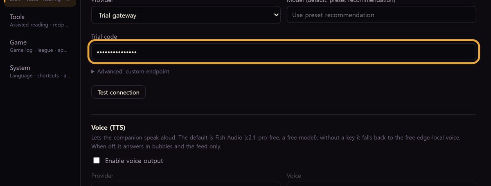

## 4. Voice: the free Fish Audio model sounds much better

- With no key you get the edge-local voice, which sounds robotic. Switching to Fish Audio's free model takes a few minutes.
- Sign up at fish.audio (no card) and create a key under API Keys in your account menu.
- **1** Provider (voice): pick "Fish Audio". Leave the model and voice fields empty to use s2.1-pro-free and the recommended voice.
- **2** API key: paste the Fish key, Test connection, Save. If you are on a trial code, leave this field alone; the code covers the voice too.
- Fish's free offer is announced until 2026-11-30; after that the app falls back to edge-local by itself. To play quietly, turn off "Enable voice output".
- Leave hearing at its defaults: recognition runs on this PC and needs no key. Without a microphone, turn off "Enable voice input" and type in the feed.

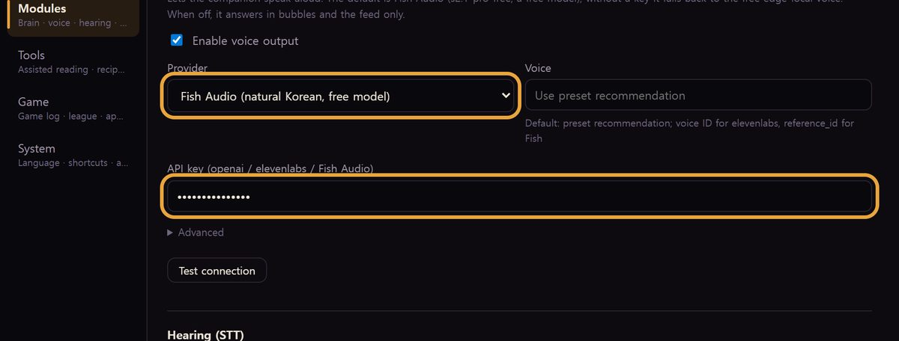

## 4-1. Decisions (opener): a word before the answer

- Further down the Modules tab, "Decisions (opener)". While the companion builds an answer, it says a short opener first, like "hold on" or "hm, that one"; this module picks one that fits the moment.
- **1** Use the opener decision model: on, a small model picks; off or without a key, one of the prepared openers is used at random. The answer itself is the same either way.
- **2** API key (OpenAI-compatible): under "Advanced". An OpenAI key or any OpenAI-compatible key works. Leaving it empty shows a note, not a warning.
- You can skip this on day one and come back when the openers feel off.

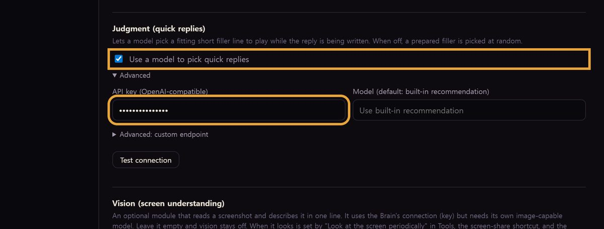

## 5. Game log and trade site

- Settings > Game. Usually everything is detected and you only check it.
- **1** Client.txt path: KakaoClient.txt for the Kakao client, Client.txt for the global client. If "Auto-detect" fails, "Browse" to the file in the logs folder.
- **2** Realm: Auto follows the client language (Korean means Kakao). It is used for price checks.
- **3** Use my trade site login (optional): switch it on and click "Log in"; the in-app browser opens. Logging in yourself gives roomier price searches and lets "my gear" questions read your character directly. The app never sees the password.

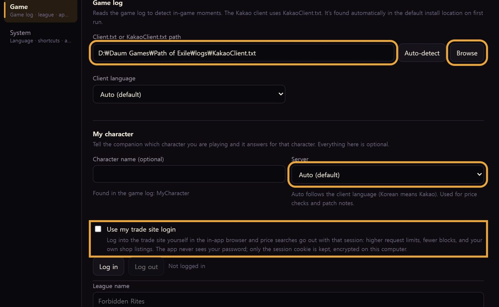

## 6. Name and personality

- Settings > Character.
- **1** Name: what the companion calls itself.
- **2** Formality: Auto reads it from the personality text. Pick one if in doubt.
- **3** Personality · Speech style: under "Advanced". Write freely, up to 2,000 characters. Chapter 7 of the manual has three sample texts.
- **4** Greeting: one per line. One is picked when you switch profiles.
- Save, and the next answer already uses it.

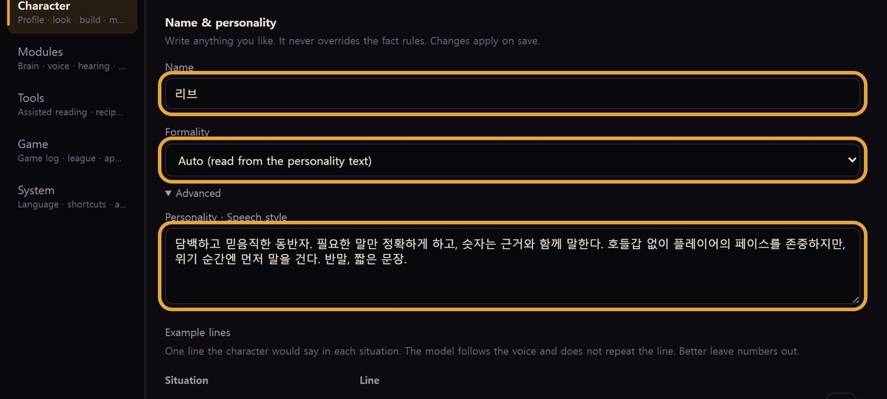

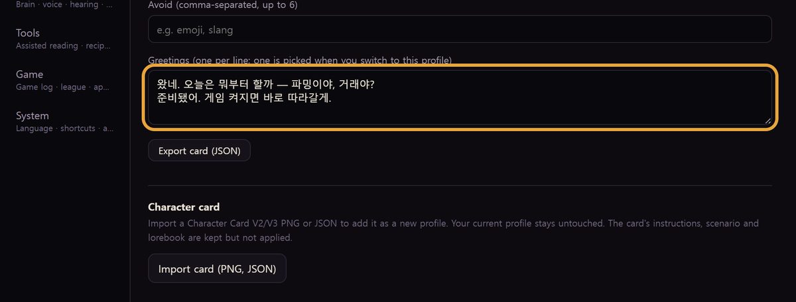

## 7. Changing the look

- Further down the Character tab, "Avatar".
- **1** Mode: Gear (the default mascot), VRM or Live2D.
- **2** VRM avatar (.vrm): "Browse" to the .vrm you downloaded. "Built-in: use Seed-san" returns to the bundled model.
- Set the size (120 to 400 px) and idle opacity with the sliders and Save.
- **3** Use the PoB calculation engine: keep it on so "what if I swap to this belt" gets numbers. The engine downloads once.
- The small picture on the right is the character window on Windows right after an external VRM was saved. Where to get models (VRoid Hub, BOOTH, Live2D) is in chapter 6 of the manual, step by step.

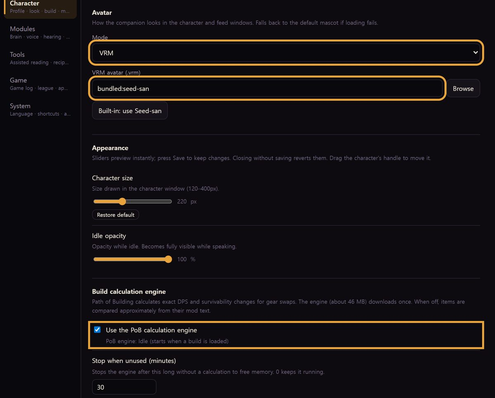

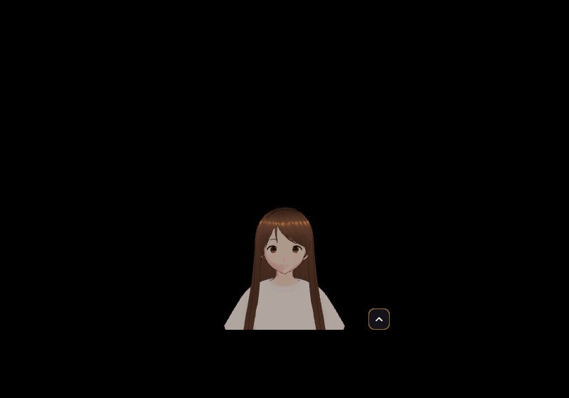

## 8. Importing a character card

- If you have a character card (PNG or JSON) made elsewhere, it brings the personality, greetings and example lines in at once.
- Character tab > Character card > "Import card (PNG, JSON)" and pick the file.
- As in the picture, "Added as a new profile: name (format)" and a thumbnail appear, and that profile is active right away. An English card comes in as English; edit the greeting if you like.

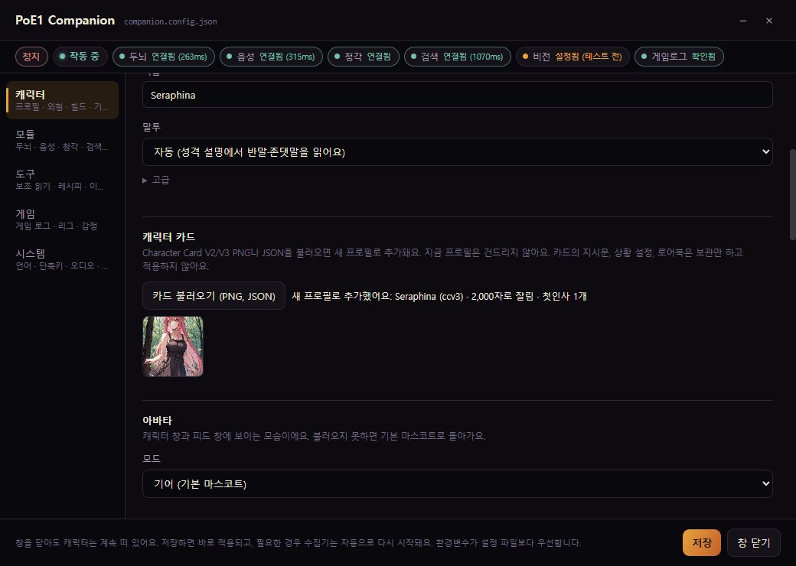

## 9. Language and hotkeys

- Settings > System. The screen language and the companion's language are set separately.
- The appraisal hotkeys default to Ctrl+D (quick price panel) and Ctrl+Alt+D (deep analysis). They work only while the game window is in front.

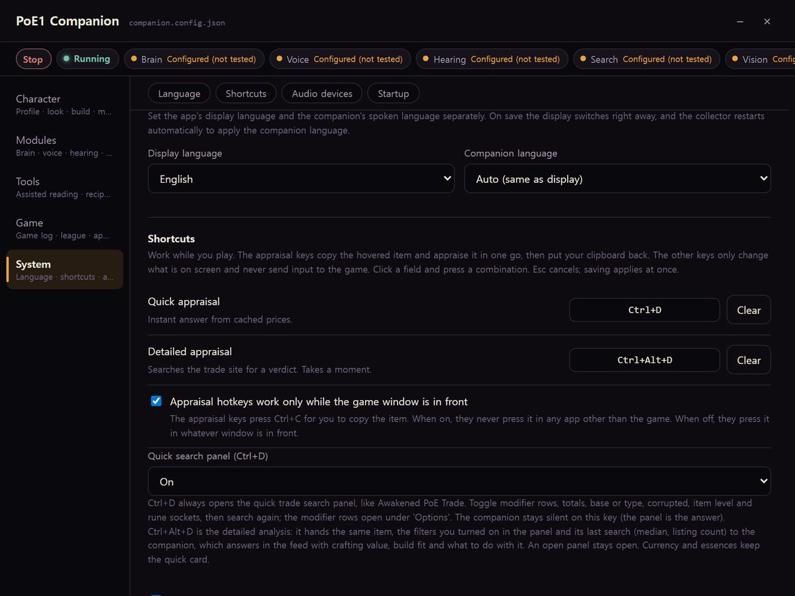

## More

- [Installer](https://github.com/ernestolee13/poe-companion-releases/releases/latest)
- [Manual (text)](https://github.com/ernestolee13/poe-companion-releases/blob/main/guides/poe1-companion-guide.en.md)
- [Overview](https://github.com/ernestolee13/poe-companion-releases/blob/main/guides/poe1-companion-intro.en.md)

PoE1 Companion 0.1.11 screens, 2026-11-13. Contact help@vibestash.app
