# PoE1 Companion 설치와 설정, 화면으로

설치부터 캐릭터 꾸미기까지 열 단계. 주황 테두리가 그 단계에서 만지는 칸입니다. 화면은 모두 윈도우 11의 실제 앱(0.1.11)입니다. 그 뒤로 몇몇 칸의 자리와 이름이 바뀌어서, 글은 0.1.66 기준으로 고쳤습니다. 그림과 다르면 글을 따라 주세요.

## 1. 설치

- GitHub 릴리스 페이지에서 Setup 파일을 받습니다. PoE1은 PoE1-Companion-Setup, PoE2는 PoE2-Companion-Setup입니다.
- SmartScreen 창이 뜨면 "추가 정보"를 누른 뒤 "실행"을 누릅니다. 아직 서명이 없는 설치 파일이라 한 번 뜹니다.
- 설치가 끝나면 앱이 켜지고 화면에 캐릭터 하나가 뜹니다.

## 2. 첫 실행과 2.5D 캐릭터 켜기

- 처음에는 톱니 마스코트가 뜹니다. 캐릭터를 누르면 피드 창이 열리고, 위쪽 "같이 시작하기" 체크리스트가 순서를 알려 줍니다.
- 첫 줄 "2.5D 캐릭터 켜기"의 열기를 누르고 Live2D 약관에 한 번 동의하면 Cubism Core를 내려받고 기본 캐릭터 히요리가 나옵니다(오른쪽 그림). 다른 모습을 쓸 거면 건너뛰어도 됩니다.
- 설정 창은 캐릭터 손잡이를 눌러 나오는 메뉴의 "설정 열기"로 엽니다. 트레이 아이콘 메뉴에도 같은 항목이 있습니다.

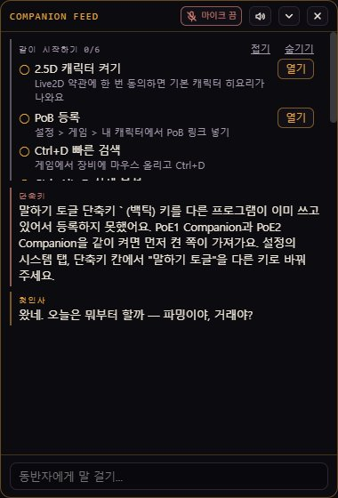

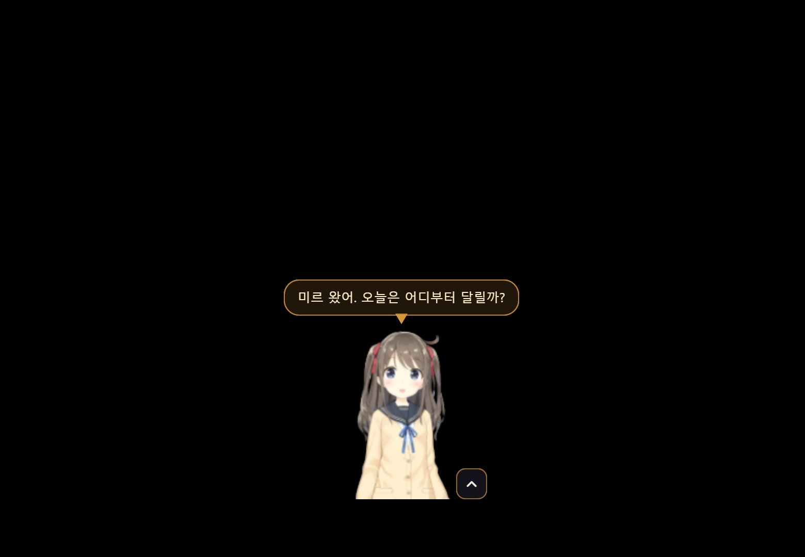

## 3. 두뇌 키 넣기 (꼭 필요한 한 칸)

- 설정 > 모듈 탭의 맨 위가 "두뇌 (대화)"입니다. 주황 테두리 순서대로 합니다.
- **1** 프로바이더: gemini, groq, openrouter 중 키를 받은 곳을 고릅니다. 무료로 받는 법은 사용설명서 1장에 있습니다.
- **2** API 키: 받은 키를 붙여 넣습니다. 모델 칸은 비워 두면 추천 모델을 씁니다.
- **3** 연결 테스트: 누르면 몇 초 안에 ✓와 응답 시간이 뜹니다. ✗가 뜨면 키를 다시 확인합니다.
- 오른쪽 아래 "저장"을 누릅니다. 창을 닫아도 캐릭터는 계속 떠 있습니다.
- 설정 창 위쪽의 "시작하기" 버튼을 누르면 동반자가 켜집니다. 멈출 때는 같은 자리의 "멈추기"를 누릅니다. 그 옆 상태 줄에는 두뇌, 음성, 청각 같은 항목이 점과 이름으로 보이고, 마우스를 올리면 자세한 내용이 나옵니다.

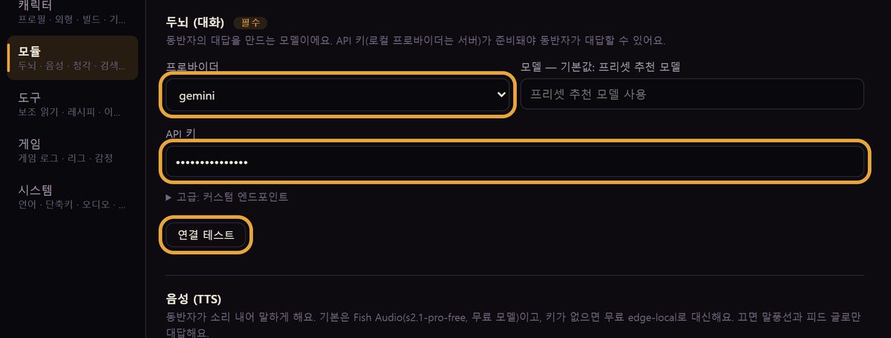

## 3-1. 체험 코드로 시작하면

- 프로바이더를 "체험 게이트웨이 (trial)"로 고르고 API 키 칸에 받은 코드를 붙여 넣습니다. 연결 테스트, 저장은 같습니다.
- 코드 하나로 두뇌, 목소리, 음성 인식이 같이 켜집니다. 코드는 help@vibestash.app 로 요청하면 드립니다(한 사람에 하나).

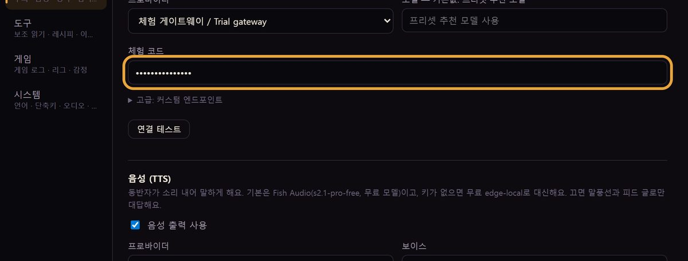

## 4. 목소리: Fish Audio 무료 모델이 훨씬 낫습니다

- 키 없이 두면 edge-local 목소리가 나오는데, 기계음이 셉니다. 몇 분이면 Fish Audio 무료 모델로 바꿀 수 있습니다.
- fish.audio 에 가입하고(카드 없음), 계정 메뉴의 API Keys에서 키를 하나 만듭니다.
- **1** 프로바이더(음성): "Fish Audio (자연스러운 한국어, 무료 모델)"을 고릅니다. 모델과 보이스 칸은 비워 두면 s2.1-pro-free와 추천 목소리를 씁니다.
- **2** API 키: Fish 키를 붙여 넣고 연결 테스트, 저장. 체험 코드를 쓰는 중이면 이 칸은 건드리지 않아도 됩니다(코드가 목소리까지 덮습니다).
- Fish 무료 제공은 2026-11-30까지로 안내돼 있고, 끝나면 앱이 edge-local로 스스로 돌아갑니다. 조용히 쓰려면 "음성 출력 사용"을 끕니다.
- 듣기(청각)는 기본값 그대로 둡니다. 이 PC 안에서 처리하는 로컬 인식이라 키가 필요 없고, 마이크가 없으면 "음성 입력 사용"을 끄고 피드에 글로 묻습니다.

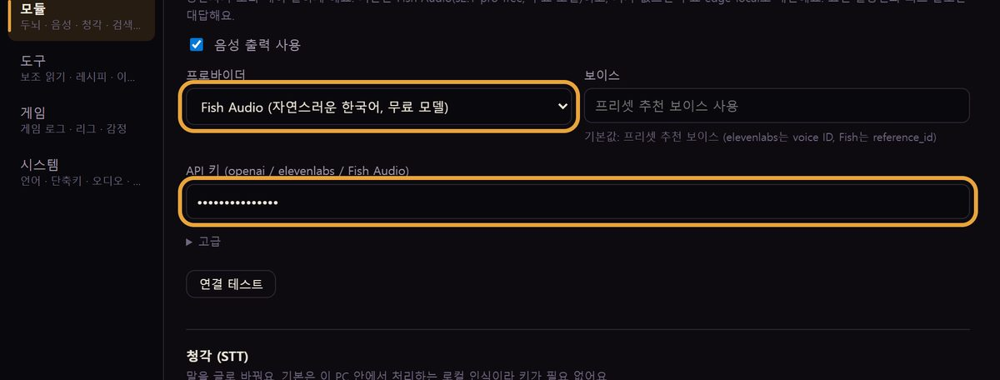

## 4-1. 대답 전 추임새: 대답이 오기 전 한마디

- 같은 모듈 탭 아래쪽 "대답 전 추임새"입니다. 그림 속 예전 이름은 "판단 (선응답)"입니다. 동반자가 답을 만드는 1초 남짓 동안 "잠깐만", "음, 그거는" 같은 짧은 추임새를 먼저 말하는데, 이 모듈이 상황에 맞는 추임새를 고릅니다.
- **1** 대답 전 추임새를 모델이 고르기: 켜 두면 작은 모델이 고르고, 끄거나 키가 없으면 미리 준비된 추임새 중 하나를 무작위로 씁니다. 어느 쪽이든 대답 자체는 같습니다.
- **2** API 키(OpenAI 호환): "고급 설정"을 펼치면 나옵니다. OpenAI 키나 OpenAI 호환 키를 넣으면 됩니다. 비워 두어도 경고가 아니라 안내만 뜹니다.
- 처음 쓸 때는 비워 두고 넘어가도 됩니다. 추임새가 상황에 안 맞는다고 느껴질 때 넣으면 됩니다.

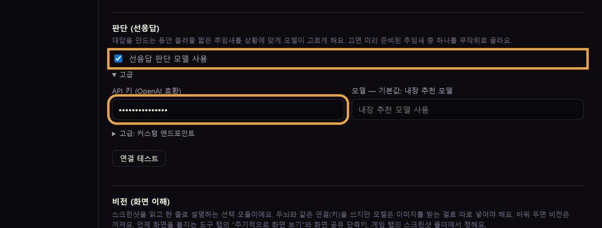

## 5. 게임 로그와 거래소

- 설정 > 게임 탭입니다. 보통은 자동으로 찾혀 있어 확인만 하면 됩니다. 지금 판에서는 게임 로그 아래로 내 캐릭터, 빌드 계산 엔진, 거래소, 아이템 감정 순서로 놓여 있고, 서버와 로그인은 "거래소" 칸에 있습니다.
- **1** Client.txt 경로: 카카오 클라이언트는 KakaoClient.txt, 글로벌은 Client.txt입니다. "자동 찾기"로 못 찾으면 "찾기"로 logs 폴더 안 파일을 고릅니다.
- **2** 서버: 자동이면 클라이언트 언어를 따라갑니다(한국어면 카카오). 시세 조회에 쓰입니다.
- **3** 거래소 로그인 세션 사용(선택): 켜고 "로그인"을 누르면 앱 안 브라우저가 열립니다. 카카오든 글로벌이든 내 계정으로 직접 로그인하면 시세 검색이 넉넉해지고 "내 장비" 질문에 캐릭터를 직접 읽습니다. 비밀번호는 앱이 보지 않습니다. 로그인은 앱을 다시 켜도 유지되고, 풀리면 상태 줄의 거래소가 "로그인 안 됨"으로 바뀝니다. 그때 다시 로그인하면 됩니다.
- "내 캐릭터 불러오기"를 누르면 지금 캐릭터에서 내 PoB 빌드를 장비 옵션까지 넣어 자동으로 만듭니다.

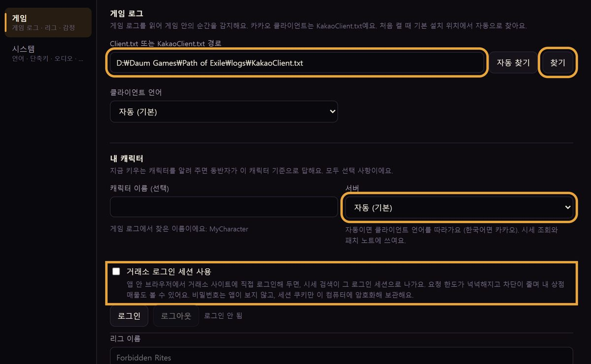

## 6. 이름과 성격

- 설정 > 캐릭터 탭입니다.
- **1** 이름: 동반자가 자기를 부르는 이름입니다.
- **2** 말투: 자동이면 성격 글에서 반말인지 존댓말인지 읽습니다. 헷갈리면 직접 고릅니다.
- **3** 성격 · 말투: "고급 설정"을 펼치면 나옵니다. 자유롭게 적되 2,000자 안입니다. 예시 글 세 편이 사용설명서 7장에 있습니다.
- **4** 첫인사: 같은 "고급 설정" 안에 있습니다. 한 줄에 하나씩. 프로필을 바꿀 때 하나를 골라 말합니다.
- 저장하면 다음 대답부터 바로 바뀝니다.

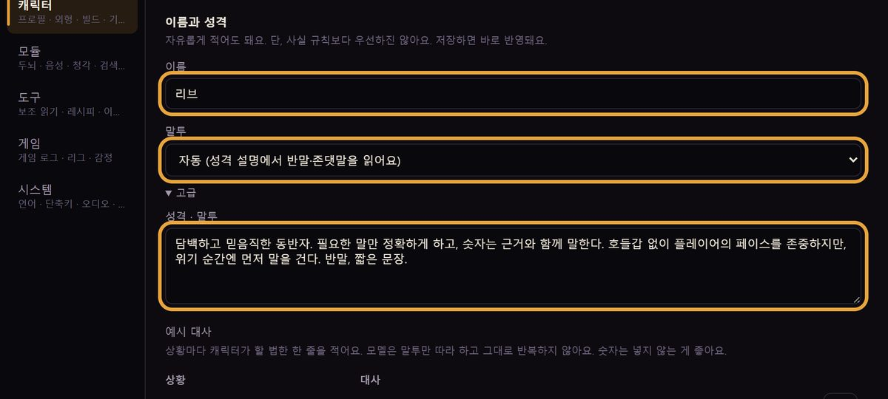

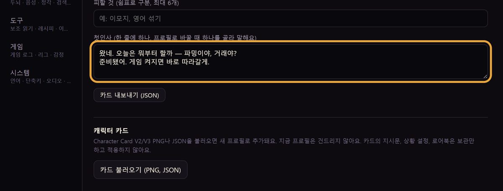

## 7. 모습 바꾸기

- 같은 캐릭터 탭의 아래쪽 "아바타"입니다.
- **1** 모드: 기어(기본 마스코트), VRM, Live2D 중 하나.
- **2** VRM 아바타(.vrm): "찾기"로 받은 .vrm 파일을 고릅니다. "기본 제공: Seed-san 사용"을 누르면 내장 모델로 돌아옵니다.
- 크기(120에서 400픽셀)와 평소 투명도는 바를 움직여 정하고 저장합니다.
- **3** PoB 계산 엔진 사용: 지금 판에서는 게임 탭의 "빌드 계산 엔진"으로 옮겨졌습니다. 켜 두면 "이 벨트로 바꾸면 어때"에 수치로 답합니다. 처음 한 번 엔진을 받습니다.
- 오른쪽 작은 그림은 윈도우에서 외부 VRM 파일을 넣고 저장한 직후의 캐릭터 창입니다. 모델 받는 곳(VRoid Hub, BOOTH, Live2D)은 사용설명서 6장에 단계별로 있습니다.

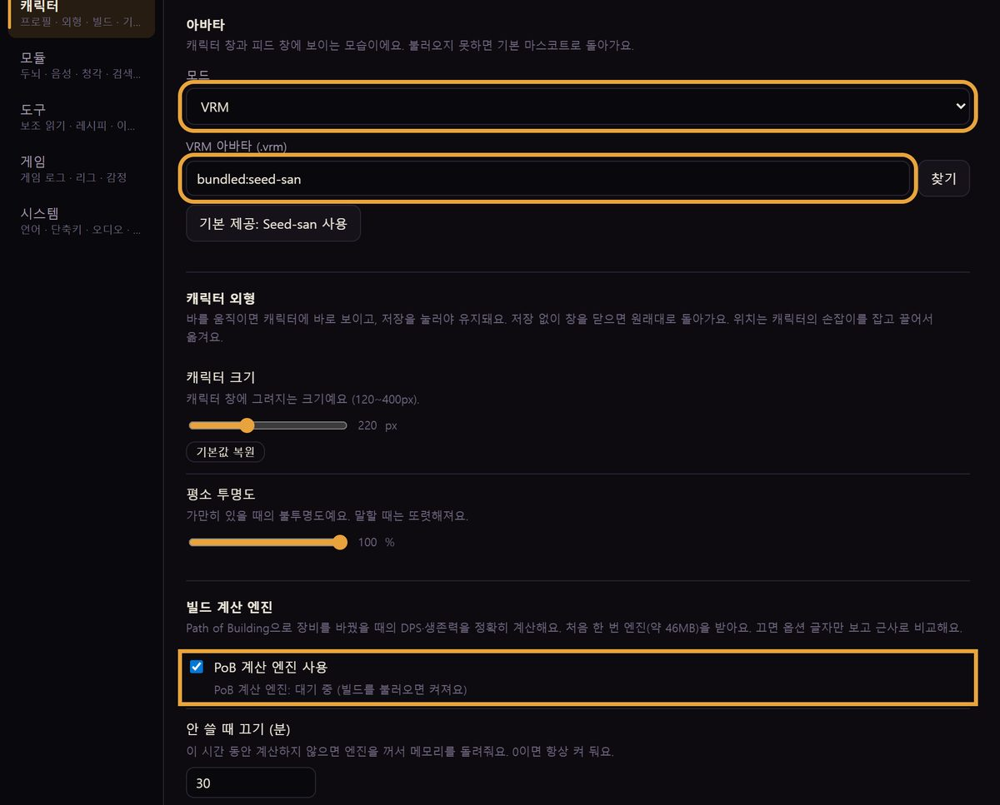

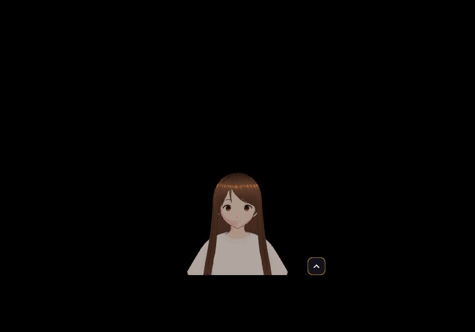

## 8. 캐릭터 카드 불러오기

- 다른 곳에서 만든 캐릭터 카드(PNG나 JSON)가 있으면 성격, 첫인사, 예시 대사를 한 번에 가져옵니다.
- 캐릭터 탭 아래쪽 "고급 설정"을 펼치고 캐릭터 카드 > "카드 불러오기 (PNG, JSON)"을 누른 뒤 파일을 고릅니다.
- 그림처럼 "새 프로필로 추가했어요: 이름 (형식)"과 썸네일이 뜨고 그 프로필이 바로 켜집니다. 영어 카드는 영어 그대로 들어오니 필요하면 첫인사만 고칩니다.

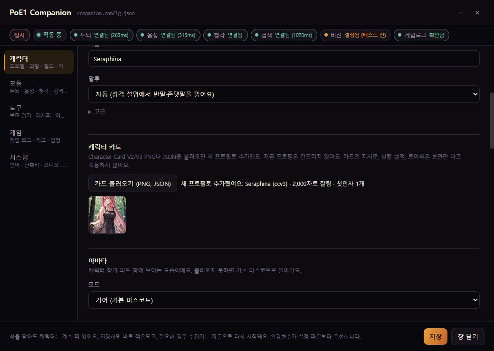

## 9. 언어와 단축키

- 설정 > 시스템 탭입니다. 화면 언어와 동반자 언어를 따로 정할 수 있습니다.
- 단축키 칸의 빠른 감정은 Ctrl+D(빠른 시세 패널), 상세 감정은 Ctrl+Alt+D가 기본입니다. 게임 창이 앞에 있을 때만 동작합니다.
- 같은 탭 아래쪽 "커뮤니티와 문의"에서 디스코드와 사용 안내를 열 수 있습니다. 문제가 생기면 "버그 신고"에 상황을 적고 "신고 내용 만들기"를 누른 뒤, 복사해서 디스코드 버그-제보 채널에 붙이고 "로그 파일 열기 (첨부용)"로 로그 파일도 첨부해 주세요. 앱이 스스로 보내는 것은 없고, 로그에는 키와 쿠키가 기록되지 않습니다.

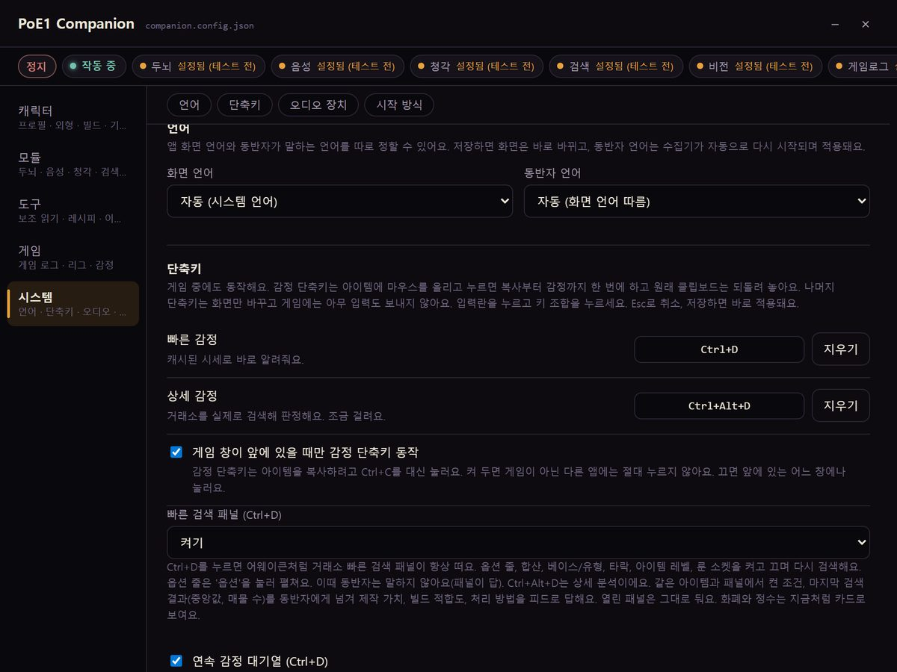

## 더 보기

- [설치 파일](https://github.com/ernestolee13/poe-companion-releases/releases/latest)
- [사용설명서 (글)](https://github.com/ernestolee13/poe-companion-releases/blob/main/guides/poe1-companion-guide.ko.md)
- [소개서](https://github.com/ernestolee13/poe-companion-releases/blob/main/guides/poe1-companion-intro.ko.md)
- [디스코드 "PoE Companion"](https://discord.gg/cTN8FhmCjs)

PoE1 Companion 0.1.11 화면(2026-11-13), 글은 0.1.66 기준. 문의 help@vibestash.app
